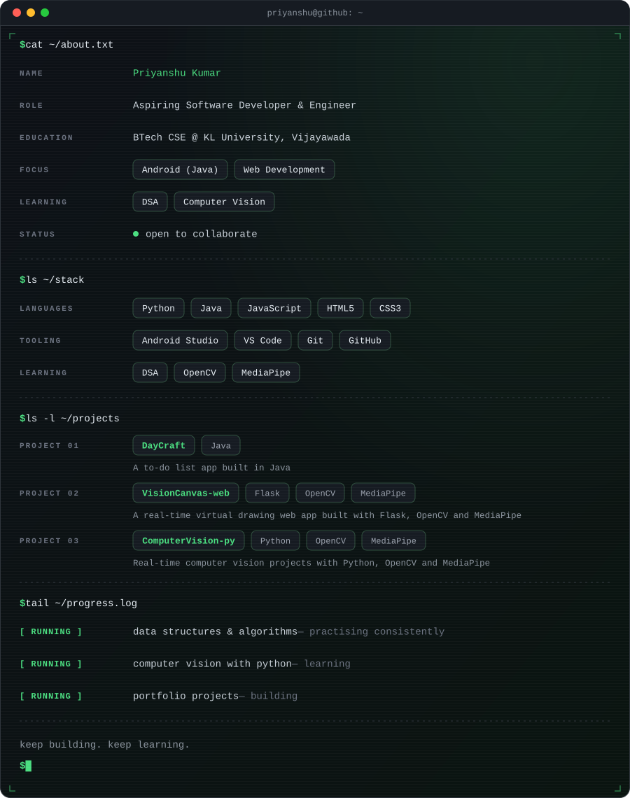

<!-- ═════════════ BANNER ═════════════ -->
<div align="center">
  
</div>

<!-- ═════════════ ABOUT ═════════════ -->
## `$ whoami`

Hey! I'm **Priyanshu Kumar** 👋 — a programming enthusiast and aspiring software developer who loves turning ideas into real-world projects.

- 🌐 **Interests:** Development, Computer Vision & AI
- 🛠️ **Building:** Creative projects that solve real-world problems
- 🧠 **Currently Learning:** Data Structures & Algorithms, software development, and new technologies
- 🚀 **Goal:** Become a better developer by learning, building, and experimenting
- 🤝 **Open to:** Collaborations, interesting projects, and learning opportunities

```python
class Developer:
    def __init__(self):
        self.name = "Priyanshu Kumar"
        self.username = "yiralcraft0"
        self.interests = ["Web Dev", "App Dev", "Computer Vision"]
        self.mindset = "Learn • Build • Improve"

    def current_status(self):
        return "Turning ideas into code 🚀"
```

<!-- ═════════════ PROFILE CARD ═════════════ -->
<div align="center">
  
</div>

<!-- ═════════════ GITHUB STATS ═════════════ -->
<div align="center">
  
  
  <br/>
  
</div>

<!-- ═════════════ SNAKE ═════════════ -->
<h2 align="center">🐍 Snake vs. My Contributions</h2>

<p align="center">
  <picture>
    <source media="(prefers-color-scheme: dark)" srcset="https://raw.githubusercontent.com/yiralcraft0/yiralcraft0/output/github-contribution-grid-snake-dark.svg">
    
  </picture>
</p>

<p align="center">
  <a href="https://yiralcraft0.github.io/portfolio-website/snake/">
    
  </a>
</p>

<!-- ═════════════ CONTACT ═════════════ -->
<h2 align="center">📫 Let's Connect</h2>

<p align="center">
  Open to collaboration on Android, web and computer vision projects.<br/>
  Pick whichever way suits you best 👇
</p>

<p align="center">
  <a href="mailto:yiralcraft0@gmail.com"></a>
  <a href="https://github.com/yiralcraft0"></a>
  <a href="https://yiralcraft0.github.io/portfolio-website/"></a>
</p>

<p align="center">
  <a href="https://www.linkedin.com/in/priyanshu-kumar-4b7943410/"></a>
  <a href="https://www.instagram.com/priyanshu0yt/"></a>
</p>

<p align="center"><i>keep building. keep learning.</i></p>